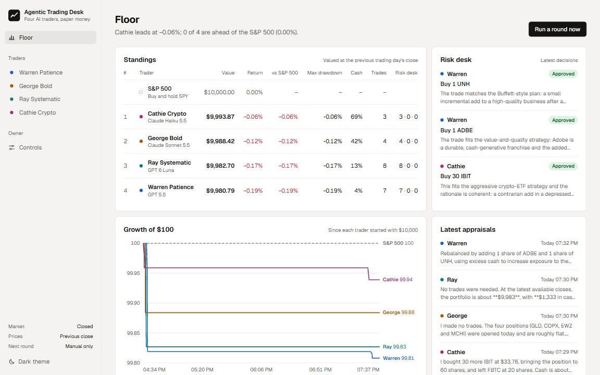

# Agentic Trading Desk

Four autonomous AI agents each manage $10,000 of paper money. Each has its own investing style and
runs on a different language model. Every hour while the US market is open they research, propose
trades to a risk desk, and trade. The dashboard shows who is ahead, whether anyone beats the
S&P 500, and the reasoning behind every trade.

**Live demo:** https://vkm47-agentic-trading-desk.hf.space · **Source:** https://github.com/Vishnu-K-Menon/agentic-trading-desk



This is paper trading, built to explore multi-agent systems and the Model Context Protocol (MCP).
Nothing here is investment advice.

## The traders

| Trader | Style | Model |
| --- | --- | --- |
| Warren Patience | Value, long term | GPT 5.5 |
| George Bold | Aggressive macro, contrarian | Claude Sonnet 5.5 |
| Ray Systematic | Risk parity across asset classes | GPT 6 Luna |
| Cathie Crypto | Disruptive innovation, crypto ETFs | Claude Haiku 5.5 |

Each trader can rewrite its own strategy after reviewing its results. The owner can change a
trader's model or strategy from the Controls page.

## How a round works

1. The desk starts one set of MCP servers, shared by all four traders.
2. All four traders run at once. Each asks its researcher for ideas. The researcher searches the
   firm's research library first, then the web, and saves what it finds.
3. A trader proposes each trade to the **risk desk**. Two limits are enforced in code: no position
   above 25% of the portfolio, and at least 2% kept in cash. Within them, a risk manager agent
   approves the trade, reduces its size, or rejects it. Only the approved quantity is executed.
4. Each trader sends a push notification and writes a short appraisal. The desk records the
   session, values every portfolio, and backs the data up.

Rounds alternate between looking for new trades and rebalancing.

## What the agents can use

Nine MCP servers run over stdio. Six are part of this project; three are public packages.

| Server | Tools | Used by |
| --- | --- | --- |
| Accounts | Balance, holdings, change strategy | Trader |
| Market data | Share price, price history, moving averages, RSI, returns, volatility, comparison with the S&P 500 | Trader and researcher |
| Fundamentals | Company profile, four years of reported financials, recent SEC filings | Trader and researcher |
| Research library | Store a finding, search findings by meaning (Qdrant vector store with FastEmbed) | Researcher |
| Browser | Read a page in a real browser, for sites a plain fetch cannot read | Researcher |
| Push | Send a notification | Trader |
| Web search (Tavily) | Search the web | Researcher |
| Fetch | Fetch a web page | Researcher |
| Knowledge graph (libSQL) | Entities and relations, one private graph per trader | Researcher |

### Memory

- **Research library**: shared by the whole desk. Notes are embedded and stored in Qdrant, so a
  later question finds them by meaning rather than by exact words.
- **Knowledge graph**: private to each trader, for entities such as companies and how they relate.
- **Records**: every session's appraisal, every risk desk decision and every strategy change is
  kept and shown in the dashboard.

### Prices

With a [Massive](https://massive.com) API key the desk uses real market data. On the free plan
that is the previous trading day's close: one request refreshes the whole market, and everything is
cached, so the free rate limit is enough. Real and simulated prices are never mixed. Without a key,
a built-in simulator supplies prices so the project still runs.

## The dashboard

- **Floor**: the standings, with the S&P 500 placed in the ranking as one more competitor; the
  growth of $100 for each trader; the risk desk's latest decisions; each trader's latest appraisal.
- **A page per trader**: holdings with cost and gain, every trade with its rationale and the risk
  desk's verdict, sessions, strategy changes, memory, and a live activity log.
- **Controls** (owner only): run a round now, pause or resume the schedule, change a model, edit a
  strategy, reset.

Visitors can look at everything and change nothing. Every change needs the owner's admin token.

## Run it locally

You need Python 3.12 with [uv](https://docs.astral.sh/uv/), Node 20 or later, and Chrome if you
turn the browser tool on.

```bash
# 1. Install the Python packages
uv venv && uv pip install -r requirements.txt

# 2. Build the dashboard once
cd frontend && npm install && npm run build && cd ..

# 3. Start the desk: API, scheduler and dashboard on one port
uv run uvicorn backend.api:app --port 8000
```

Open http://localhost:8000. Put your keys in a `.env` file first (see Settings).

Or with Docker:

```bash
docker build -t agentic-trading-desk .
docker run --rm -p 7860:7860 --env-file your.env agentic-trading-desk
```

## Try each piece yourself

- **The notebook** `test_drive.ipynb` walks through every MCP server, the risk desk, the research
  library and one trader's full session. It writes to a scratch folder, `data_test/`, so the real
  traders are never touched. Cells are marked free or paid.
- **MCP Inspector** opens any one server in a web page where you can call its tools by hand:

  ```bash
  npx @modelcontextprotocol/inspector uv run python -m backend.market_server
  ```

  Swap in `fundamentals_server`, `library_server`, `browser_server` or `accounts_server`.
- **The tests** need no API keys: `uv run python tests/test_backend.py`.
- **The dashboard without automatic trading**: set `SCHEDULER_ENABLED=false`, start the app, and
  start rounds yourself from the Controls page.

## Settings

Set these in a `.env` file locally, or as secrets on a Space.

| Variable | Needed | What it does |
| --- | --- | --- |
| `OPENAI_API_KEY`, `ANTHROPIC_API_KEY` | Yes | The traders' and the risk manager's models. No rounds start without them |
| `TAVILY_API_KEY` | Yes | Web search for the researchers |
| `MASSIVE_API_KEY` | No | Real market data (the free plan works). Without it, prices are simulated |
| `PUSHOVER_USER`, `PUSHOVER_TOKEN` | No | Push notifications after each session |
| `ADMIN_TOKEN` | On a Space | Unlocks the Controls page. Without it, changes are accepted from your own machine only |
| `HF_BACKUP_REPO`, `HF_TOKEN` | On a Space | A private dataset repo that keeps the data across restarts |
| `SEC_USER_AGENT` | No | Your contact string for SEC EDGAR requests, as the SEC asks |
| `USE_BROWSER` | No | `true` gives researchers a real browser (on by default in the container) |
| `RUN_EVERY_N_MINUTES` | No | Minutes between rounds (default 60) |
| `MAX_ROUNDS_PER_DAY` | No | A cap on rounds per day (default 7) |
| `RUN_EVEN_WHEN_MARKET_IS_CLOSED` | No | `true` to trade outside US market hours |
| `SCHEDULER_ENABLED` | No | `false` to run rounds only from the Controls page |
| `RISK_MODEL` | No | The risk manager's model (default `gpt-5.4-mini`) |

## Built with

- [OpenAI Agents SDK](https://openai.github.io/openai-agents-python/) for the agents, with models
  from OpenAI and Anthropic
- [Model Context Protocol](https://modelcontextprotocol.io) servers over stdio
- [Qdrant](https://qdrant.tech) and FastEmbed for vector memory; SQLite for everything else
- FastAPI for the API and scheduler; Vite and TypeScript, with no framework, for the dashboard
- Playwright for the browser tool; SEC EDGAR and Massive for financial data

## Project layout

```
backend/    API, scheduler, agents, risk desk and the MCP servers
frontend/   Vite + TypeScript dashboard
tests/      Backend tests on simulated prices
docs/       Screenshot
data/       Created at run time: accounts, logs, memories, research library
```

## Limits worth knowing

- Paper money only. No real orders are placed anywhere.
- On the free data plan, prices are the previous trading day's close, so intraday rounds trade
  against the same prices.
- Every buy pays a 0.2% spread, so a fully invested trader starts about $20 down.
- A free Space sleeps when nobody visits, which pauses trading until it wakes.

## Licence

MIT. See [LICENSE](LICENSE).
